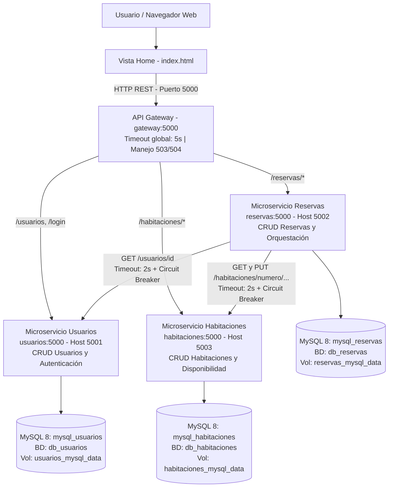

# Hotel Grand Plaza — Sistema de Reservas Distribuido

## 1. Descripción del sistema

La gestión tradicional de reservas hoteleras suele presentar problemas de descentralización, duplicidad de reservas sobre una misma habitación en la misma fecha, falta de visibilidad sobre la disponibilidad real y fallos en cascada cuando algún módulo deja de responder.

**Hotel Grand Plaza** soluciona esta problemática mediante una arquitectura distribuida basada en **microservicios independientes**, un **API Gateway** como punto único de entrada (`http://localhost:5000`), persistencia aislada por dominio en contenedores **MySQL 8** y mecanismos de tolerancia a fallos (**Timeout** y **Circuit Breaker** con `pybreaker`).

### Funcionalidades principales por rol
* **Cliente (`cliente`):** Inicio de sesión, consulta de catálogo de habitaciones disponibles, creación de nuevas reservas (con validación distribuida de disponibilidad), consulta de su historial y cancelación de reservas.
* **Administrador (`admin`):** Visualización global de todas las reservas, consulta detallada consolidada (reserva + datos del cliente + datos de la habitación), actualización de estado (`confirmada`, `pagada`, `cancelada`) con sincronización automática del estado de la habitación, y gestión CRUD completa del inventario de habitaciones.
* **Administrador del sistema (`sysadmin`):** Gestión CRUD completa de cuentas de usuario y asignación de roles (`cliente`, `admin`, `sysadmin`).

---

## 2. Arquitectura completa del sistema

Todos los contenedores se orquestan mediante **Docker Compose** dentro de una red interna compartida (`default`), donde los servicios se descubren por nombre de contenedor (`usuarios`, `reservas`, `habitaciones`, `mysql_*`). La interfaz web (`index.html`) consume exclusivamente el **API Gateway** en el puerto `5000`.



---

## 3. Microservicios (Inventario de servicios)

| Microservicio | Responsabilidad | Base de datos | Comunicación con otros servicios | Estado |
| :--- | :--- | :--- | :--- | :--- |
| **Vista Home** (`index.html`) | Interfaz web cliente con vistas diferenciadas por rol (`cliente`, `admin`, `sysadmin`). | Ninguna (cliente web) | Consume el **API Gateway** (`http://localhost:5000`). | Implementado |
| **API Gateway** (`gateway`) | Punto de entrada único (`:5000`), enrutamiento HTTP, preservación de códigos de estado y gestión de indisponibilidad (`503`/`504`). | Ninguna | Reenvía peticiones hacia **Usuarios**, **Reservas** y **Habitaciones** por red interna Docker. | Implementado |
| **Usuarios** (`usuarios`) | Gestión CRUD de cuentas de usuario, roles y autenticación (`POST /login`). | `db_usuarios` (MySQL 8) | Responde consultas HTTP (`GET /usuarios/{id}`) desde **Reservas**. | Implementado |
| **Habitaciones** (`habitaciones`) | Gestión CRUD del inventario de habitaciones, tarifas, capacidad y estado (`disponible` / `ocupada`). | `db_habitaciones` (MySQL 8) | Responde consultas y actualizaciones de estado desde **Reservas**. | Implementado |
| **Reservas** (`reservas`) | Gestión CRUD de reservas, validación de disponibilidad, sincronización de habitaciones y consulta consolidada. | `db_reservas` (MySQL 8) | Consulta a **Usuarios** y **Habitaciones** vía HTTP con **Timeout** y **Circuit Breaker**. | Implementado |

---

## 4. Endpoints y manejo de errores HTTP

Todas las solicitudes externas ingresan a través del **API Gateway** (`http://localhost:5000`).

### Códigos de estado HTTP estandarizados

| Código | Estado | Contexto de uso en la aplicación |
| :--- | :--- | :--- |
| `200` | OK | Consulta (`GET`), actualización (`PUT`), eliminación (`DELETE`) o login exitoso. |
| `201` | Created | Registro exitoso de un usuario, habitación o reserva (`POST`). |
| `400` | Bad Request | Campos obligatorios faltantes o tipos de datos inválidos en la solicitud. |
| `401` | Unauthorized | Credenciales inválidas en `POST /login`. |
| `404` | Not Found | El identificador de usuario, habitación o reserva no existe en la base de datos. |
| `409` | Conflict | Habitación duplicada, habitación no disponible o conflicto de reserva en la misma fecha. |
| `500` | Internal Server Error | Error interno de base de datos o excepción no controlada en el servidor. |
| `502` | Bad Gateway | Respuesta de error inesperada recibida desde un microservicio dependiente. |
| `503` | Service Unavailable | Servicio destino caído/inaccesible o **Circuit Breaker en estado `OPEN`**. |
| `504` | Gateway Timeout | Tiempo máximo de espera (`Timeout`) excedido al esperar respuesta de otro servicio. |

### Endpoints del API Gateway (`gateway` — `:5000`)

| Método | Ruta pública | Servicio destino | Descripción |
| :--- | :--- | :--- | :--- |
| `GET` | `/health` | `gateway` | Verifica el estado activo del Gateway y las URLs internas configuradas. |
| `ANY` | `/usuarios`, `/usuarios/{ruta}` | `http://usuarios:5000` | Enruta operaciones CRUD hacia el microservicio Usuarios. |
| `POST` | `/login` | `http://usuarios:5000` | Enruta la autenticación de credenciales hacia Usuarios. |
| `ANY` | `/habitaciones`, `/habitaciones/{ruta}` | `http://habitaciones:5000` | Enruta operaciones CRUD y consultas por número hacia Habitaciones. |
| `ANY` | `/reservas`, `/reservas/{ruta}` | `http://reservas:5000` | Enruta operaciones CRUD, detalles consolidados y estado de circuitos hacia Reservas. |

### Endpoints del Microservicio Usuarios (`usuarios`)

| Método | Endpoint | Operación | Entrada (JSON) | Respuestas |
| :--- | :--- | :--- | :--- | :--- |
| `GET` | `/usuarios` | Read (Listar) | Ninguna | `200` Lista de usuarios / `500` |
| `GET` | `/usuarios/{id}` | Read (Detalle) | Parámetro `id` (documento) | `200` Objeto usuario / `404` No encontrado |
| `POST` | `/usuarios` | Create | `{"id", "nombre", "correo", "contrasena", "rol"}` | `201` Usuario creado / `400` Datos faltantes |
| `PUT` | `/usuarios/{id}` | Update | `{"nombre", "correo", "rol", "contrasena"}` | `200` Actualizado / `400` Sin campos |
| `DELETE` | `/usuarios/{id}` | Delete | Parámetro `id` | `200` Eliminado / `500` |
| `POST` | `/login` | Autenticación* | `{"correo", "contrasena"}` | `200` Usuario y rol / `401` Inválido |

*\*Nota: `POST /login` corresponde a la responsabilidad de autenticación del dominio de usuarios.*

### Endpoints del Microservicio Habitaciones (`habitaciones`)

| Método | Endpoint | Operación | Entrada (JSON / Query) | Respuestas |
| :--- | :--- | :--- | :--- | :--- |
| `GET` | `/habitaciones` | Read (Listar) | Query opcional `?estado=disponible` | `200` Lista de habitaciones / `500` |
| `GET` | `/habitaciones/{id}` | Read (Por ID) | Parámetro numérico `id` | `200` Objeto habitación / `404` |
| `GET` | `/habitaciones/numero/{numero}` | Read (Por número) | Parámetro `numero` (ej. `101`) | `200` Objeto habitación / `404` |
| `POST` | `/habitaciones` | Create | `{"numero", "tipo", "capacidad", "precio", "estado", "descripcion"}` | `201` Creada / `400` / `409` Duplicada |
| `PUT` | `/habitaciones/{id}` | Update | Campos a modificar de la habitación | `200` Actualizada / `404` / `409` |
| `PUT` | `/habitaciones/numero/{numero}/estado` | Update estado* | `{"estado": "ocupada" \| "disponible"}` | `200` Estado actualizado / `404` |
| `DELETE` | `/habitaciones/{id}` | Delete | Parámetro numérico `id` | `200` Eliminada / `404` |

*\*Nota: `GET` y `PUT` por `/numero/{numero}` permiten la sincronización desacoplada con el microservicio Reservas.*

### Endpoints del Microservicio Reservas (`reservas`)

| Método | Endpoint | Operación | Entrada (JSON) | Respuestas |
| :--- | :--- | :--- | :--- | :--- |
| `GET` | `/reservas` | Read (Listar) | Ninguna | `200` Lista de todas las reservas |
| `GET` | `/reservas/usuario/{usuario_id}` | Read (Por cliente) | Parámetro `usuario_id` | `200` Reservas del cliente |
| `GET` | `/reservas/{id}/detalles` | Read consolidado* | Parámetro `id` | `200` `{reserva, usuario, habitacion}` / `404` / `503` / `504` |
| `POST` | `/reservas` | Create | `{"habitacion", "usuario_id", "fecha_reserva", "estado"}` | `201` Reserva creada / `400` / `404` / `409` / `503` / `504` |
| `PUT` | `/reservas/{id}/estado` | Update estado* | `{"estado": "confirmada" \| "pagada" \| "cancelada"}` | `200` Estado actualizado / `404` |
| `DELETE` | `/reservas/{id}` | Delete | Parámetro `id` | `200` Cancelada y habitación liberada / `404` |
| `GET` | `/reservas/circuito/usuarios` | Monitoreo CB* | Ninguna | `200` Estado del Circuit Breaker de Usuarios |
| `GET` | `/reservas/circuito/habitaciones` | Monitoreo CB* | Ninguna | `200` Estado del Circuit Breaker de Habitaciones |

*\*Nota: Los endpoints de detalles consolidados, cambio de estado y monitoreo de circuitos responden a la orquestación de negocio y observabilidad de tolerancia a fallos.*

---

## 5. Bases de datos

Cada microservicio administra exclusivamente su propia instancia **MySQL 8** independiente, sin compartir tablas ni realizar consultas cruzadas entre esquemas:

| Microservicio | Contenedor / Puerto | Base de datos | Tabla principal | Columnas principales | Operaciones implementadas |
| :--- | :--- | :--- | :--- | :--- | :--- |
| **Usuarios** | `mysql_usuarios` (`3310:3306`) | `db_usuarios` | `usuarios` | `id` (PK), `nombre`, `correo`, `contrasena`, `rol` | `SELECT`, `INSERT`, `UPDATE`, `DELETE` |
| **Reservas** | `mysql_reservas` (`3309:3306`) | `db_reservas` | `reservas` | `id` (PK AI), `habitacion`, `usuario_id`, `fecha_reserva`, `estado` | `SELECT`, `INSERT`, `UPDATE`, `DELETE` |
| **Habitaciones** | `mysql_habitaciones` (`3311:3306`) | `db_habitaciones` | `habitaciones` | `id` (PK AI), `numero` (UNIQUE), `tipo`, `capacidad`, `precio`, `estado`, `descripcion` | `SELECT`, `INSERT`, `UPDATE`, `DELETE` |

---

## 6. Persistencia

La persistencia de datos se garantiza mediante volúmenes nombrados declarados en `docker-compose.yml`:
* `usuarios_mysql_data` montado en `/var/lib/mysql` de `mysql_usuarios`.
* `reservas_mysql_data` montado en `/var/lib/mysql` de `mysql_reservas`.
* `habitaciones_mysql_data` montado en `/var/lib/mysql` de `mysql_habitaciones`.

### Verificación de persistencia
1. Se registran registros nuevos vía `POST /usuarios`, `POST /habitaciones` y `POST /reservas`.
2. Se detienen los contenedores de aplicación sin eliminar volúmenes (`docker compose stop usuarios habitaciones reservas` o `docker compose down` sin `-v`).
3. Se vuelven a iniciar los servicios (`docker compose up -d`).
4. Al consultar `GET /usuarios`, `GET /habitaciones` y `GET /reservas`, todos los registros previos permanecen intactos.

---

## 7. Comunicación entre servicios

La comunicación entre microservicios se realiza exclusivamente mediante peticiones HTTP REST internas utilizando la resolución DNS nativa de Docker Compose (`http://usuarios:5000`, `http://habitaciones:5000`, `http://reservas:5000`):

| Servicio solicitante | Servicio destino | Endpoint | Método HTTP | Información intercambiada |
| :--- | :--- | :--- | :--- | :--- |
| **Reservas** | **Habitaciones** | `/habitaciones/numero/{numero}` | `GET` | **Envía:** número de habitación.<br>**Recibe:** datos y estado (`disponible`/`ocupada`) antes de crear una reserva o al consultar detalles. |
| **Reservas** | **Habitaciones** | `/habitaciones/numero/{numero}/estado` | `PUT` | **Envía:** `{"estado": "ocupada" \| "disponible"}`.<br>**Recibe:** confirmación de sincronización al crear, actualizar o eliminar una reserva. |
| **Reservas** | **Usuarios** | `/usuarios/{usuario_id}` | `GET` | **Envía:** documento del cliente.<br>**Recibe:** `{id, nombre, correo, rol}` para consolidar `GET /reservas/{id}/detalles`. |
| **API Gateway** | **Usuarios / Reservas / Habitaciones** | `/usuarios/*`, `/login`, `/reservas/*`, `/habitaciones/*` | `GET`, `POST`, `PUT`, `DELETE` | Reenvía parámetros, cuerpo JSON y método original del cliente; preserva el código HTTP de respuesta. |

---

## 8. Timeout y Circuit Breaker

La tolerancia a fallos está implementada en el microservicio **Reservas** mediante la librería **`pybreaker`** y tiempos máximos de espera (`timeout`) en `requests`, además del timeout global de `5 s` en el **API Gateway**.

### Configuración implementada

| Parámetro | Valor implementado | Descripción |
| :--- | :--- | :--- |
| **Servicio que realiza la solicitud** | `reservas` | Microservicio consumidor de Usuarios y Habitaciones. |
| **Servicios protegidos** | `usuarios` y `habitaciones` | Circuitos independientes: `circuito_usuarios` y `circuito_habitaciones`. |
| **Timeout configurado (Reservas → Servicios)** | `2 segundos` | Variables `USUARIOS_TIMEOUT=2` y `HABITACIONES_TIMEOUT=2`. Retorna `504 Gateway Timeout` si se excede. |
| **Timeout configurado (API Gateway)** | `5 segundos` | `requests.request(..., timeout=5)` en `gateway/app.py`. Retorna `504` si el servicio tarda demasiado. |
| **Umbral de fallos (`fail_max`)** | `3 fallos` | Variable `CB_MAX_FALLOS=3`. Fallos consecutivos necesarios para abrir el circuito. |
| **Tiempo de recuperación (`reset_timeout`)** | `30 segundos` | Variable `CB_RECUPERACION=30`. Tiempo en estado `OPEN` antes de pasar a `HALF_OPEN`. |

### Estados del Circuit Breaker y ciclo de recuperación
1. **`CLOSED` (Normal):** Las peticiones hacia `usuarios` y `habitaciones` fluyen normalmente. Cada fallo técnico (timeout, error de conexión o HTTP `>= 500`) incrementa `fallos_consecutivos`; una petición exitosa lo reinicia a `0`.
2. **`OPEN` (Circuito abierto):** Al acumular **3 fallos consecutivos**, el circuito se abre. Durante **30 segundos**, las solicitudes protegidas fallan rápido (*fail-fast*) con **`503 Service Unavailable`** sin esperar tiempos muertos de red.
3. **`HALF_OPEN` (Semi-abierto):** Pasados los **30 segundos**, el circuito permite una solicitud de prueba. Si la dependencia responde correctamente, el circuito regresa a **`CLOSED`**; si vuelve a fallar, retorna inmediatamente a **`OPEN`**.

### Endpoints de inspección de circuitos (vía Gateway)
* `GET http://localhost:5000/reservas/circuito/usuarios`
* `GET http://localhost:5000/reservas/circuito/habitaciones`

### Procedimiento de prueba de fallos y recuperación
```bash
# 1. Verificar estado inicial CLOSED
curl http://localhost:5000/reservas/circuito/usuarios

# 2. Detener el microservicio Usuarios sin borrar volúmenes
docker compose stop usuarios

# 3. Ejecutar 3 solicitudes a /reservas/{id}/detalles para provocar apertura (OPEN)
curl http://localhost:5000/reservas/1/detalles

# 4. Confirmar estado OPEN y rechazo inmediato (HTTP 503)
curl http://localhost:5000/reservas/circuito/usuarios

# 5. Restablecer el microservicio y esperar 30 segundos (HALF_OPEN -> CLOSED)
docker compose start usuarios
curl http://localhost:5000/reservas/1/detalles
```

---

## 9. API Gateway

El servicio `gateway` (`reserva_hotel/gateway/app.py`) centraliza el acceso de los clientes externos en `http://localhost:5000`:
* **Desacoplamiento:** El frontend y los clientes HTTP solo conocen `localhost:5000`, sin acoplarse a los puertos internos de cada microservicio.
* **Preservación de contratos:** Reenvía métodos (`GET`, `POST`, `PUT`, `DELETE`), parámetros de consulta (`query params`), cuerpos JSON y códigos de estado exactos (`200`, `201`, `400`, `401`, `404`, `409`, `500`).
* **Gestión de errores de red:** Captura `requests.exceptions.Timeout` (`504`) y `requests.exceptions.ConnectionError` (`503`) devolviendo respuestas JSON controladas.

---

## 10. Docker Compose y ejecución

### Archivo `.env.example`
Las credenciales y URLs internas se gestionan mediante variables de entorno (sin subir `.env` con secretos reales a GitHub):

```env
USUARIOS_URL=http://usuarios:5000
RESERVAS_URL=http://reservas:5000
HABITACIONES_URL=http://habitaciones:5000

# Base de datos del servicio Reservas
DB_HOST_RESERVAS=mysql_reservas
DB_PORT_RESERVAS=3306
DB_USER_RESERVAS=root
DB_PASSWORD_RESERVAS=root
DB_NAME_RESERVAS=db_reservas

# Base de datos del servicio Usuarios
DB_HOST_USUARIOS=mysql_usuarios
DB_PORT_USUARIOS=3306
DB_USER_USUARIOS=root
DB_PASSWORD_USUARIOS=root
DB_NAME_USUARIOS=db_usuarios

# Base de datos del servicio Habitaciones
DB_HOST_HABITACIONES=mysql_habitaciones
DB_PORT_HABITACIONES=3306
DB_USER_HABITACIONES=root
DB_PASSWORD_HABITACIONES=root
DB_NAME_HABITACIONES=db_habitaciones

# Tolerancia a fallos (Timeouts y Circuit Breaker)
USUARIOS_TIMEOUT=2
HABITACIONES_TIMEOUT=2
CB_MAX_FALLOS=3
CB_RECUPERACION=30
```

### Despliegue paso a paso

```bash
# 1. Ubicarse en la carpeta del proyecto Docker
cd reserva_hotel

# 2. Preparar archivo de variables de entorno
cp .env.example .env

# 3. Construir imágenes y levantar los 7 contenedores en segundo plano
docker compose up -d --build

# 4. Verificar que todos los servicios estén activos (Up)
docker compose ps
```

* **API Gateway:** `http://localhost:5000` (Healthcheck: `http://localhost:5000/health`)
* **Vista Home:** Abrir `reserva_hotel/index.html` en el navegador (conectado a `http://localhost:5000`).
* **Comunicación interna vs. puertos externos:** Dentro de Docker Compose los contenedores se comunican por red interna usando su nombre de servicio en el puerto interno `5000` (microservicios) y `3306` (MySQL). Solo es indispensable exponer hacia el host el puerto `5000` del **API Gateway**; los puertos `5001`–`5003` y `3309`–`3311` se mantienen mapeados únicamente para depuración y sustentación directa.

---

## 11. Pruebas (Matriz de verificación integral)

| Prueba | Resultado esperado | Resultado obtenido | Evidencia |
| :--- | :--- | :--- | :--- |
| **Arquitectura completa** | Todos los servicios (`gateway`, `usuarios`, `reservas`, `habitaciones`, 3 BDs y `index.html`) implementados e integrados. | Cumplido | `docs/arquitectura.md` |
| **Docker Compose** | 7 contenedores ejecutándose correctamente con `docker compose ps`. | Cumplido | `docs/pruebas/docker_ps.png` |
| **CRUD Usuarios** | `POST` (`201`) → `GET` (`200`) → `PUT` (`200`) → `DELETE` (`200`) → `GET` inexistente (`404`). | Cumplido | `docs/pruebas/crud_usuarios.png` |
| **CRUD Habitaciones** | `POST` (`201`) → `GET` (`200`) → `PUT` (`200`) → `DELETE` (`200`) → `GET` inexistente (`404`). | Cumplido | `docs/pruebas/crud_habitaciones.png` |
| **CRUD Reservas** | `POST` (`201`) → `GET` (`200`) → `PUT /estado` (`200`) → `DELETE` (`200`) → `GET` inexistente (`404`). | Cumplido | `docs/pruebas/crud_reservas.png` |
| **Bases de datos y persistencia** | Datos conservados tras detener y recrear contenedores sin eliminar volúmenes. | Cumplido | `docs/pruebas/persistencia.png` |
| **Comunicación HTTP** | `POST /reservas` valida y ocupa habitación; `GET /reservas/{id}/detalles` consolida reserva, usuario y habitación. | Cumplido | `docs/pruebas/comunicacion_http.png` |
| **Timeout** | Demora superior a `2 s` en Usuarios o Habitaciones devuelve error controlado `504 Gateway Timeout`. | Cumplido | `docs/pruebas/timeout.png` |
| **Circuit Breaker CLOSED** | En operación normal el circuito está en `CLOSED` y permite solicitudes. | Cumplido | `docs/pruebas/cb_closed.png` |
| **Circuit Breaker OPEN** | Tras detener un servicio y alcanzar 3 fallos, cambia a `OPEN` y rechaza con `503`. | Cumplido | `docs/pruebas/cb_open.png` |
| **Recuperación (HALF_OPEN → CLOSED)** | Al reiniciar el servicio y cumplirse `30 s`, prueba en `HALF_OPEN` y retorna a `CLOSED`. | Cumplido | `docs/pruebas/cb_recovery.png` |
| **API Gateway** | Todas las rutas de Usuarios, Habitaciones y Reservas operan desde `http://localhost:5000`. | Cumplido | `docs/pruebas/gateway.png` |
| **Vista Home integrada** | Login, consulta de habitaciones disponibles, reserva y gestión por roles desde `index.html` vía Gateway. | Cumplido | `docs/pruebas/home_integrado.png` |

---

## 12. Estado actual, estructura y equipo

### Funcionalidades terminadas
* Implementación completa de los microservicios **Usuarios**, **Habitaciones** y **Reservas** con operaciones CRUD y bases de datos MySQL 8 independientes.
* Integración centralizada mediante **API Gateway** (`:5000`) y **Vista Home** (`index.html`).
* Tolerancia a fallos mediante **Timeout** (`2 s` / `5 s`) y doble **Circuit Breaker** (`pybreaker`) con estados `CLOSED`, `OPEN` y `HALF_OPEN`.
* Persistencia con volúmenes Docker y documentación técnica actualizada.

### Aspectos pendientes (mejoras futuras)
* Hashing seguro de contraseñas (`bcrypt`) y autenticación basada en tokens JWT.
* Servicio asíncrono de notificaciones por correo electrónico al confirmar o cancelar reservas.

### Estructura del repositorio
```text
reservas_hotel/
├── docs/
│   ├── arquitectura.md
│   ├── definición_servicios.md
│   └── pruebas/
├── reserva_hotel/
│   ├── gateway/
│   │   ├── app.py
│   │   ├── dockerfile
│   │   └── requirements.txt
│   ├── usuarios/
│   │   ├── app.py
│   │   ├── database.py
│   │   ├── dockerfile
│   │   └── requirements.txt
│   ├── habitaciones/
│   │   ├── app.py
│   │   ├── database.py
│   │   ├── dockerfile
│   │   └── requirements.txt
│   ├── reservas/
│   │   ├── app.py
│   │   ├── database.py
│   │   ├── dockerfile
│   │   └── requirements.txt
│   ├── index.html
│   ├── docker-compose.yml
│   ├── .env.example
│   └── .env
└── README.md
```
